

<picture>
  <source media="(prefers-color-scheme: dark)" srcset="assets/hero-dark.svg">
  
</picture>

<picture>
  <source media="(prefers-color-scheme: dark)" srcset="assets/about-dark.svg">
  
</picture>

<picture>
  <source media="(prefers-color-scheme: dark)" srcset="assets/stack-dark.svg">
  
</picture>

<picture>
  <source media="(prefers-color-scheme: dark)" srcset="assets/section-projects-dark.svg">
  
</picture>

<a href="https://github.com/CAKeysama/prancha"><picture><source media="(prefers-color-scheme: dark)" srcset="assets/project-prancha-dark.svg"></picture></a>
<a href="https://github.com/CAKeysama/DevDrop"><picture><source media="(prefers-color-scheme: dark)" srcset="assets/project-devdrop-dark.svg"></picture></a>
<a href="https://github.com/CAKeysama/Ultra-loot"><picture><source media="(prefers-color-scheme: dark)" srcset="assets/project-ultraloot-dark.svg"></picture></a>
<a href="https://github.com/CAKeysama/ReTool"><picture><source media="(prefers-color-scheme: dark)" srcset="assets/project-retool-dark.svg"></picture></a>

Também: <a href="https://github.com/CAKeysama/Retool-mobile">ReTool Mobile</a> (Flutter) · <a href="https://eletrica-sabia.vercel.app">Elétrica Sábia</a> (site institucional) · <a href="https://devdrop-ten.vercel.app">DevDrop ao vivo</a> · <a href="https://prancha-beta.vercel.app">site do Prancha</a>

<picture>
  <source media="(prefers-color-scheme: dark)" srcset="assets/section-activity-dark.svg">
  
</picture>

<picture>
  <source media="(prefers-color-scheme: dark)" srcset="https://raw.githubusercontent.com/CAKeysama/CAkeysama/output/github-snake-dark.svg">
  
</picture>

<picture>
  <source media="(prefers-color-scheme: dark)" srcset="assets/contact-dark.svg">
  
</picture>

<a href="https://www.linkedin.com/in/gustavo-d-silva-33b044228/"><picture><source media="(prefers-color-scheme: dark)" srcset="assets/btn-linkedin-dark.svg"></picture></a>
<a href="https://www.instagram.com/gustvo_d/"><picture><source media="(prefers-color-scheme: dark)" srcset="assets/btn-instagram-dark.svg"></picture></a>
<a href="mailto:contato.gustavo.silva02@gmail.com"><picture><source media="(prefers-color-scheme: dark)" srcset="assets/btn-email-dark.svg"></picture></a>

